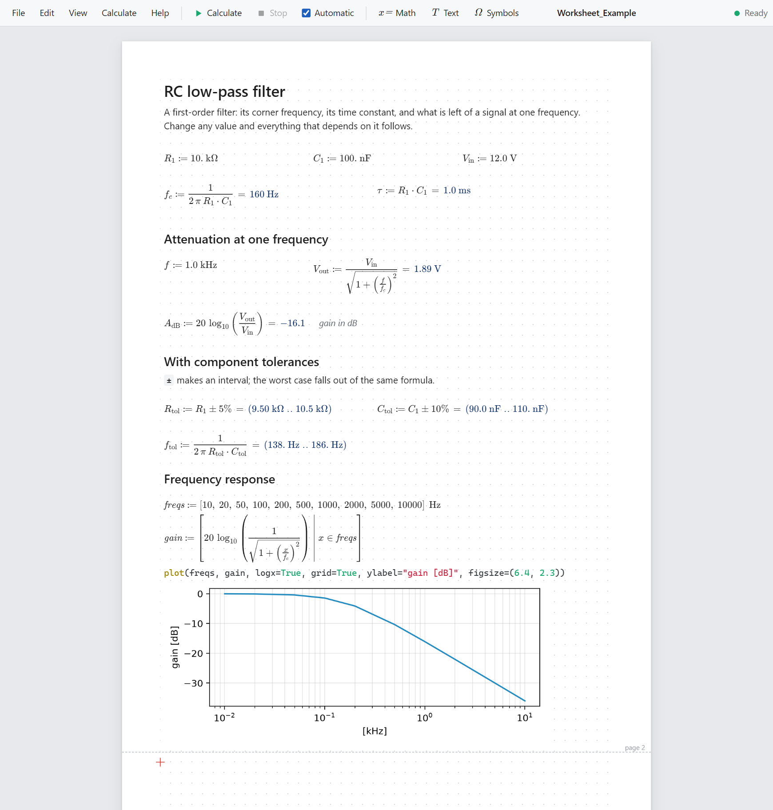

# Worksheet

A Mathcad-style front end for the Engineering DSL: a page on which you
place math and text freely, with the math drawn as built-up notation,
each result beside its formula, and the whole sheet recalculated when
anything changes.



The page above is [`Worksheet_Example.ipynb`](../Worksheet_Example.ipynb).
A worksheet *is* a notebook: the same file opens in JupyterLab and VS
Code and runs the same calculation there.

## Starting it

```bash
python -m utils.worksheet                         # a new sheet, in this folder
python -m utils.worksheet Worksheet_Example.ipynb # open (or start) that sheet
python -m utils.worksheet path/to/folder          # work in that folder
```

A browser tab opens on the sheet. The terminal keeps running the
worksheet server; Ctrl+C there stops it (and its kernels).

Options: `--port N` (default 8791; the next free port is taken if it is
busy), `--no-browser`, `--app` (a chromeless Edge/Chrome window instead
of a tab), `--palette` (also start the Windows symbol palette, which a
sheet does not need: see *The library*).

The worksheet is installed with the toolkit's `all` extra — see
[Install](../README.md#install) in the README. It needs `tornado`,
`jupyter_client`, `nbformat` and `ipykernel`, all present wherever
JupyterLab is installed; if one is missing, the command says which and
how to add it. `edsl-worksheet` is the same command as
`python -m utils.worksheet` (an editable install made before the
worksheet existed gets it by running `pip install -e .` again).

### As an app (Windows)

`--app` gives the sheet a window of its own, without the browser's tabs
and address bar — in Edge, or in Chrome where Edge is not installed.
For an icon to double-click, make a shortcut (right-click the desktop →
New → Shortcut) with this as its location, the path being the one
`where python` prints:

    "C:\path\to\python.exe" -m utils.worksheet --app

Then, in the shortcut's Properties, set *Start in* to the folder your
sheets live in and *Run* to *Minimized*; *Change Icon…* takes the
worksheet's own icon, `utils\worksheet\static\icon.ico` in the
toolkit's folder. The console window that stays minimized is the
worksheet server: close it when you are done.

## The page

The white area is an A4 page. A red cross marks the cursor.

| Do this | and this happens |
|---|---|
| click on empty paper | the cursor goes there |
| just type | a math region starts at the cursor |
| `"` | a text region starts; it is written as it looks — see [Writing text](#writing-text) |
| **Enter** | the region is finished; the cursor moves below it |
| **Shift+Enter** | another line in the same region |
| **Esc** | leave a math region as it was / finish a text region |
| click a region | edit it |
| drag a region | move it (while editing: drag its blue grip) |
| drag across empty paper | select regions — arrows nudge, **Del** deletes, Ctrl+C/X/V copy and paste |
| **Tab** / **Shift+Tab** | edit the next / previous region |
| **Ctrl+Enter** / **Ctrl+Backspace** | open / close a line of space at the cursor |
| **Ctrl+Z** / **Ctrl+Y** | undo / redo |
| drag the right edge of a text region | change its width |
| **Ctrl+V** with a picture on the clipboard | the picture is put at the cursor — see [Pictures](#pictures) |
| **Ctrl+V** with formatted text on the clipboard | it becomes a text region at the cursor — see [Writing text](#writing-text) |

A region that grows pushes the regions under it down rather than
overlap them, and a region that fits on a page is never split across
two (the dashed lines are the page breaks). *Arrange → Split region
into statements* turns a many-line region (a notebook cell, say) into
one region per statement.

### Arranging

Select regions — drag across empty paper, or Ctrl+A for all — and
line them up from the **Arrange** menu or the eight buttons in the bar
(they light up when enough is selected):

| Command | What it does |
|---|---|
| **Left edges**, **Centres**, **Right edges** | puts the selection on one vertical line: that of its own outline. Nothing moves up or down |
| **Tops**, **Middles**, **Bottoms** | puts it on one horizontal line. Regions that would then lie on each other move to the right, clear of their neighbour |
| **Space out evenly: Across**, **Down** | three regions or more: the outer two stay, the others get equal space between them (if there is too little room for that, the regions take the room they need) |

With a single region selected, *Left edges*, *Centres* and *Right
edges* align it on the page instead — *Centres* centres a plot or a
heading. Ctrl+Z takes an arrangement back in one step. Regions are
calculated in the order they are read, so arranging can change that
order; the sheet then recalculates.

*View → Grid* shows a dotted grid to place regions by (it is never
printed). Whether it is shown, whether the symbol panel is open, and
whether text is written as its markdown, is remembered on this computer
for every sheet — it is your way of working, not part of a worksheet.

A notebook that was never laid out — any existing notebook — opens with
its cells one under the other and keeps flowing like that, growing and
shrinking as a document does, until you place something yourself. From
then on regions stay where you put them.

### Pictures

**Ctrl+V** puts the picture on the clipboard at the cursor: a
screenshot, a picture copied in another program, a picture file copied
in Explorer. **Picture** in the bar takes pictures from files, and a
picture file dropped on the page lands where it is dropped (dropped
beside the page, it goes to the cursor). PNG, JPEG, GIF, WebP and BMP
are taken as they are, up to 20 MB each.

| Do this | and this happens |
|---|---|
| click a picture | it is selected: drag it to move it, **Del** deletes it, Ctrl+C/V copy it |
| drag its right edge | it gets narrower or wider and keeps its shape |
| double-click it (or **Enter** when it is selected) | the text that names it opens: write a caption under it there, and the two are one text region |
| **Ctrl+V** or **Picture** while writing a text region | the picture goes into the text, at the caret |

A picture comes in at its own size, or as wide as the page if it is
wider, and the cursor waits below it. On the page a picture is taken
before words the clipboard holds beside it; into a text being written
the words go.

**Drawings (SVG) stay drawings** — sharp at any size and on paper:

- an `.svg` file, chosen, dropped, or copied in Explorer;
- SVG source copied as text (cut out of a web page, it need not even
  have its namespace);
- a drawing copied in a program that puts SVG on the clipboard. A
  browser hands such a drawing only to a page that may read the
  clipboard, and asks you the first time. Refused, the page pastes the
  bitmap that the program put beside the drawing, and says so.

What a program offers only as a bitmap arrives as a bitmap.

A picture is stored in the sheet's file the way JupyterLab stores a
pasted one: attached to a text cell that names it
(``). So it is there in JupyterLab and in
`hardcopy()` too — at its own size, not the one you gave it on the
page. A drawing is stored with a bitmap copy beside it, because
JupyterLab shows bitmaps only; `hardcopy()` and the worksheet show the
drawing. A sheet is saved with up to 100 MB of pictures.

## How a sheet calculates

Regions are calculated **top to bottom, and left to right on the same
line**. A name must be defined above (or to the left of) where it is
used; moving a region changes the order, and the sheet follows.

Each pass gives exactly what running everything from the top in a
fresh kernel would give — a deleted definition is really gone.

| Write | to |
|---|---|
| `V_in := 12.0 V` | define a value (`=` works too). A value that was *calculated* is shown after its definition; one written out in full is not repeated |
| `V_out` | show a value (`V_out =`, Mathcad's habit, is accepted and tidied to this) |
| `V_out ▸ mV` | show it in a unit of your choice |
| a line ending in `;` | show nothing |
| `f := x → x² + 1` | define a function; `f(3)` uses it |
| `# text` after a statement | annotate it — comments are set beside the math |

*View → Show results* switches between calculated values only (the
default), every definition, and only where asked.

Statements that are not formulas — `pp(…)`, `plot(…)`, loops,
`import` — are shown as source, with their output underneath.
`%%python` at the top of a region makes it plain Python, as in a
notebook.

### Errors

A statement that fails turns red and gets a flag; hover (or click the
flag) for the message. The other statements — in that region and below
— still calculate, and those that needed the failed value say so. An
error takes no room on the page, so a passing mistake does not shove
the sheet around. The status at the top right counts the regions with
errors; click it to go to the first.

### Calculating on demand

*Automatic* (on by default) recalculates after every change. With it
off, changed regions are dimmed until **F9**. **Ctrl+F9** recalculates
everything from scratch. **Stop** (or Esc) interrupts a calculation:
the statement it was in is flagged, and what lies below keeps its old
values, dimmed. *Calculate → Restart the kernel* starts a fresh Python.

### What is not run again

Changing one number does not run the whole sheet: a statement whose
inputs have the values they had last time is not executed again; its
recorded result (plot included) is reused. The rules err on the side
of running:

- a statement is reused only if every name it reads has the same
  *value* as before — and, for lists, arrays and matrices, is the very
  same object, so aliases stay aliases;
- a statement that changes an object in place (`xs.append(…)`,
  `M[0, 0] = …`) always runs, and whatever it changed is made afresh;
- anything involving the clock, random numbers, files, `pv()` without
  arguments, or a module other than the toolkit and the numeric
  libraries (numpy, sympy, scipy, math …) always runs — so does raw
  `matplotlib.pyplot`; the toolkit's own `plot()` is reused;
- values the engine cannot compare reliably (objects of your own
  classes, figures) are recalculated every time.

Results that depend on something outside the sheet and are *not* in
that list — currency rates, a data file read by a function of yours —
are refreshed by **Ctrl+F9**.

## Typing the notation

The source of a math region is ordinary DSL text; everything the symbol
palette types works, and so does pasting from a notebook. Two aids:

- **`\name`** becomes a glyph as soon as the name ends: `\ohm` Ω,
  `\mu` μ, `\pi` π, `\sqrt` √, `\cdot` ·, `\par` ‖, `\pm` ±, `\to` →,
  `\show` ▸, `\deg` °, `\approx` ≈, `\le` ≤ … and all Greek letters.
  Sets, logic and calculus use the LaTeX names — `\subseteq` ⊆,
  `\setminus` ∖, `\and` ∧, `\not` ¬, `\partial` ∂, `\int` ∫, `\sum` ∑.
  A list appears while you type; Tab picks from it.
- **`^`** followed by digits types a power: `cm^2` → `cm²`,
  `10^-3` → `10⁻³`. `\_1` types an index (`R₁`, element 1 of `R`);
  `R_1` with a plain underscore is a name of its own. Letters go up or
  down the same way: `x\^n` → `xⁿ`, `xs\_n\_+\_1` → `xsₙ₊₁`.
- **`\time`** and **`\rome`** type the marks that make a string a date
  or duration (`"PT90M"ₜᵢₘₑ`) or a Roman numeral (`"MMXXVI"ᵣₒₘₑ`).

**F2** opens the symbol panel; resting the pointer on a key shows the
names that type it, at the bottom of the panel. While you type, the
statement under the caret is shown typeset below the editor.

### The library

The symbol panel has the palette's whole library, so a sheet is written
without the Windows symbol palette — and the worksheet does not start
it. (In a notebook, importing the toolkit brings the palette up; a
sheet's kernel imports it with `ENGINEER_HEADLESS=1`, which says not
to. `python -m utils.worksheet --palette` starts it as a notebook
would.)

The panel's first tab, *Keys*, is the keypad of everyday glyphs. The
other tabs — Math, Greek, Sub/Sup, Engineering, Sets, Constants,
Symbolic, Matrix, Plotting, ISO 286, Units, Currency, Loops, Numbers,
Various — are the palette's own: functions, `▸ unit` targets,
constants, templates and literals, some 640 entries, each with a line
that says what it is for.

| Do this | and this happens |
|---|---|
| rest the pointer on an entry | the bottom of the panel says what it is for |
| click an entry | it goes in at the caret (or starts a math region at the cursor); the caret is left in its first open place, as in `atan2(▮, )` |
| **Tab** | the caret goes to the next open place |
| **Enter** | finishes the region — from inside the brackets too |
| **Ctrl+E** | search the library: type words (`bode`, `kilo`, `roman numeral`), the arrows choose, Enter inserts. The region being edited stays open |
| `\` and a word, in a math region | the list also offers the library's entries with that word — `\bode`, `\hypot`, `\kWh`. Tab or Enter picks one |

The entries are the palette's, not a copy to keep up by hand: see
*For developers*.

### Writing text

A text region is written as it looks: what is bold is bold while you
type it, a list is a list, a formula is drawn. A bar above the region
has the formatting, and the keys do the same.

| Do this | and this happens |
|---|---|
| **Ctrl+B**, **Ctrl+I**, **Ctrl+U** | bold, italic, underlined — what is selected, or what is typed next |
| **Ctrl+Shift+X**, **Ctrl+,**, **Ctrl+.**, **Ctrl+<** | struck through, lowered (H₂O), raised (x²), code |
| the list in the bar, or **Ctrl+Shift+1** … **6** and **Ctrl+Shift+0** | a heading of that level, or ordinary text again (Backspace at the start of a heading does that, too) |
| **Ctrl+Shift+8**, **Ctrl+Shift+9**, **Ctrl+'** | a bulleted list, a numbered list, a quotation — and out of it again. **Enter** goes on with the next item, and an empty item ends the list; **Tab** and **Shift+Tab** move an item in and out |
| **Ctrl+K** | a field for the address the selected text is to link to. With the caret in a link it shows where the link goes; emptied, it takes the link off |
| **Shift+Enter** | a new line in the same paragraph. (In code, where Enter is a new line, it leaves the code) |
| **↑** or **↓** out of a table, a formula, a list or code that the text begins or ends with | a paragraph is made there, to write above or below it |
| **Esc**, **Ctrl+Enter**, or a click elsewhere | the text is finished |

Markdown's own marks work as they are typed: `# ` begins a heading
(`## ` a smaller one), `- ` a list, `1. ` a numbered list, `> ` a
quotation and three backticks a block of code; `**bold**`, `*italic*`,
`~~struck~~` and `` `code` `` format what is between them, `$x^2$`
becomes a formula and `$$…$$` one on a line of its own. Backspace
right after takes such a mark back, and the characters stand as typed.

**Copy and paste.** Formatted text pasted from another program — a word
processor, a web page, a mail — keeps what a text region has: headings,
bold, italic, underlined, struck, lowered and raised text, code, links,
lists, tables, and pictures that come with it as data (they are
attached to the region, like any picture). Colours, fonts and sizes
stay behind, a table's first row becomes its header, and cells that
span several become single cells. Nothing that is pasted is ever run,
and a link that would run something is no link. Plain text is read as
the markdown it may be, each of its lines a line; **Ctrl+Shift+V** puts
it in exactly as it is. What is copied out of a text goes on the
clipboard twice: as formatted text for programs that take that (a
formula as its LaTeX between dollars, a picture as what it shows), and
as markdown for those that take plain text.

**Pasted on the page** — with the cursor on the paper, not in a text —
formatted text becomes a text region of its own: left selected, as a
pasted picture is, with the cursor below it. Text without formatting
is taken as it is typed, a math region: nothing on the clipboard says
whether it is prose or a calculation, so start a text region with `"`
first when it is prose. Code copied in an editor of programs is
formatted as well — in a `<pre>`, or with its line ends kept by its
style — and is taken as typed, too. So is anything pasted with
**Ctrl+Shift+V**.

**In the file a text region is markdown**, as in every notebook. What
markdown has no mark for is kept as the HTML tag for it — `<u>`,
`<sub>`, `<sup>` — which JupyterLab and `hardcopy()` show as the
worksheet does. A paragraph, list or table that you do not change is
written back exactly as it stood, so working on one part of a text
that someone spelled by hand does not respell the rest.

To see or write the markdown itself, press **Markdown** in the bar:
the text goes on as its markdown, in the editor math regions have.
*View → Write text as Markdown* makes that the way every text region
opens — on this computer, like the grid, until you turn it off.

### Formulas and tables in text

The panel's last two tabs are the palette's two tools for text, and
work on the text region you are writing — or start one at the cursor.

**Formula** is a formula editor (MathLive, the one the palette uses).
Write the formula as you would say it — `a/b` makes a fraction, `^` a
power, `_` an index, `\` begins a name such as `\alpha`, `\sqrt` or
`\int` — and it is drawn as you type, with the `$…$` it stands for
shown underneath.

| Do this | and this happens |
|---|---|
| **Enter** (or *Insert in the line*) | the formula goes into the text, drawn, and you go on writing after it |
| **Shift+Enter** (or *Insert on its own line*) | it goes in on a line of its own, and you go on writing below it |
| click a formula in the text, then click the editor | the editor takes that formula up; Enter puts the changed one in its place — or, with the other button, as the other kind |
| double-click a formula in the text (or **Enter** when it is selected) | its LaTeX opens where it stands; Enter puts it back, Esc leaves it as it was |
| tick *On-screen keyboard* | MathLive's keyboard of symbols is shown while the editor has the focus |

**Table** makes a table to write over: choose the number of columns
and rows and how the columns are set (left, centred, right), and
*Insert the table*. Its first header is selected, ready to be typed
over. In any table of a text region, **Tab** goes to the next cell
(Shift+Tab to the previous one) and after the last cell adds a row;
**↑** and **↓** go to the cell above and below.

With text written as its markdown, the tools write markdown: `$…$`,
`$$…$$` set apart by blank lines, and a table of pipes and dashes in
which Tab goes from cell to cell as well.

The built-up form is drawn from the code that will actually run, so it
shows how your input was understood: `12 V / 3 A` appears as one
quantity over another; `m c²` shows an upright m, because that `m` is
the metre.

## Files

A worksheet is saved as `.ipynb`:

- each region is a cell, in reading order, so the notebook runs the
  same calculation top to bottom;
- where a region sits is stored in the cell's metadata (`edsl`), which
  Jupyter carries along untouched; a sheet that still flows stores none;
- the `from utils.Engineer import *` cell is kept as the first cell
  (the worksheet itself does not show it);
- what a region shows is saved as the cell's output, so results are
  visible in JupyterLab and on GitHub without running anything (run
  there, a cell shows what a notebook shows — nothing, for a
  definition);
- a text region is a markdown cell, formatted as markdown formats
  (with `<u>`, `<sub>` and `<sup>` for what markdown has no mark for);
- a picture is a text cell with the picture attached to it; pictures
  that a notebook brings along (pasted in JupyterLab, say) are shown,
  and one that no text names any more is not saved again;
- the sheet's header and footer, with their logo, and its title, author
  and revision are in the notebook's own metadata (`edsl_worksheet`),
  beside its settings;
- tags, attachments and other metadata of existing cells are preserved.

If the file was changed by another program while open, saving asks
before overwriting. The kernel works in the sheet's own folder, so
relative paths in a sheet mean what they mean in a notebook there;
opening a sheet from another folder, or saving one into it, restarts
the kernel in that folder.

### Sheets from elsewhere

Opening a sheet does not run it. A notebook that was not last saved
on this computer is shown typeset, with its stored output, and a bar
offering **Calculate**. Choosing that (or saving from the worksheet)
records the file as trusted — in Jupyter's own trust store, so
JupyterLab agrees — and it opens calculated from then on.

## Printing

*File → Print* (Ctrl+P) prints the page as you see it — A4, 15 mm
margins, no grid or controls. Choose "Save as PDF" in the browser's
dialog for a PDF. A sheet prints on the pages it fills: the room the
screen keeps below the last region, for the cursor and for going on,
is not paper. Every page comes out of the printer as the screen has
it, however long the sheet is. For the linear notebook rendering
instead, the existing `print_view()` / `hardcopy()` work on the same
file. They show a sheet as it was saved: `hardcopy(execute=True)` and
`python hardcopy.py`, which run a notebook fresh before exporting it,
do not run a sheet, because a notebook shows no value for a definition
and the results would be gone.

While a page is printed, the bar of every root sign (and the shaft of
every stretchy arrow and brace) is drawn only as long as its box.
KaTeX draws them 400em long and hides the rest, which a screen and a
PDF do faithfully; on paper such a bar has been seen running to the
left of its root sign.

### Header and footer

*File → Header and footer…* gives every page a header, a footer, or
both; a double click on one that is there opens the dialog again. Each
has three cells — left, centre, right. A cell is written as text is
(`**bold**`, `*italic*`, `$x^2$`), each of its lines is a line, and it
may hold fields, which say something about the sheet or the page:

| Field | says |
|---|---|
| `{file}`, `{name}`, `{folder}` | the sheet's file name — `Torque.ipynb` — the same without its ending, and the folder the file is in |
| `{title}`, `{author}` | what you give the sheet for them, in the same dialog. The title is the file's name until you do |
| `{revision}` | how many times the sheet has been saved with something changed. Type a number there to count on from — or anything else, `B` or `1.2`, which then stays as it is typed |
| `{saved}`, `{saved-time}` | the day, and the time of day, of the last such save |
| `{date}`, `{time}` | the day, and the time of day, of printing |
| `{page}`, `{pages}` | the number of the page, and how many pages there are |
| `{logo}` | the logo: a picture you choose in the dialog (PNG, JPEG, GIF, WebP, BMP or an SVG drawing, up to 2 MB), shown 4 to 40 mm high |

The dialog draws header and footer as they will be while you set them:
with a line under the one and over the other if you want it, and with
dates written the way you choose.

Header and footer are on the page — on screen as on paper — and take
their room from it: a line of text takes 4.2 mm, a logo its height.
Regions keep their places on the sheet, and a page holds a little less
of it; a region that the new end of a page would cut moves to the next
page, as it does when a region above it grows. A click on a header or
a footer puts the cursor at the nearest place of that page. The page
that the screen shows for going on, with nothing on it yet, has its
header and footer faded: it is not paper. (A browser has a header and
footer of its own for what it prints — the date, the page's address.
Where it adds them, untick *Headers and footers* under *More settings*
in its print dialog.)

**Templates.** A template is a header and footer under a name. Three
are ready-made — *Page numbers*, *File and date*, and *Title block*
with a place for a logo — and *Save as template…* keeps what you have
set, logo and all, as one of your own: on this computer, for every
sheet. *New sheets*, in the same dialog, chooses the template that a
new sheet starts with. A sheet holds a copy of what it was given, so
it looks the same on another computer, and changing a template later
changes no sheet.

Only a sheet with a header or a footer counts its saves and notes when
it was saved; a sheet without them is saved as it always was.

## Security

The server executes code, so it is closed to everything but its own
page: it listens on 127.0.0.1 only; every request needs the token in
the address printed at start-up (exchanged for a cookie on first use);
and requests carrying another site's `Origin`, or a `Host` other than
the server's own, are refused. Files are read and written only below
the folder the server was started in.

## Limits

- A math region is edited as source text with a live typeset preview;
  the built-up formula itself is not edited in place.
- A text region holds what markdown can say. There are no colours,
  fonts or sizes, no cells that span several, and a table's first row
  is always its header.
- A picture is part of the sheet's file. One that a text only points to
  — ``, a file beside the notebook — is not
  shown (the text is kept as it is).
- A picture cannot be cropped or turned. Copying one puts its region
  on the clipboard, for this or another sheet; another program gets
  formatted text with the picture in it, which not every program takes
  as a picture.
- Interactive widgets (`ipywidgets`) and top-level `await` are not
  supported; output is text, typeset math, images and tables.
- One sheet per browser tab; each has its own kernel. A second tab on
  the same address opens another sheet.
- The page is A4 portrait.
- Header and footer are the worksheet's: JupyterLab and `hardcopy()`,
  which show a sheet as a notebook, do not show them. They are the
  same on every page, the first included. A region that is higher
  than a page runs across the footer and header of the pages it
  crosses.

## For developers

| Module | Role |
|---|---|
| `utils/worksheet/server.py` | tornado server: page, notebook API, WebSocket |
| `utils/worksheet/session.py` | one kernel per sheet; request/reply plumbing |
| `utils/worksheet/engine.py` | *in the kernel*: splits regions into statements, runs them, decides what can be reused |
| `utils/worksheet/fingerprint.py` | "same value as last time?" for the reuse rules |
| `utils/worksheet/mathrender.py` | transformed-Python AST → LaTeX |
| `utils/worksheet/document.py` | `.ipynb` ⇄ worksheet document, trust |
| `utils/worksheet/prefs.py` | what the user chose for the page (grid, symbol panel, text as markdown, the template of a new sheet): a file in Jupyter's data folder, because a browser keeps its own storage per port |
| `utils/worksheet/templates.py` | the headers and footers a user keeps by name: another file there |
| `utils/worksheet/static/` | the front end: plain ES modules, no build step |
| `utils/worksheet/make_library.py` | writes `static/data/library.json` — the symbol panel's library — from the Windows palette's list |
| `utils/worksheet/make_icon.py` | writes `static/icon.ico` from the drawings `static/icon.svg` and `static/icon-small.svg` (needs Playwright and a Chromium) |

The library has one source: the palette's
`SymbolPaletteWinUI/Services/SymbolRepository.cs`. After changing it,
run

```bash
python -m utils.worksheet.make_library
```

and commit the regenerated `library.json` with it;
`tests/test_worksheet_library.py` fails while the two differ. The same
test file checks that every character the library pastes can also be
typed from the *Keys* tab and by a backslash name
(`static/js/symbols.js`).

Math is typeset by [KaTeX](https://katex.org) 0.19.0 (MIT), vendored
with its licence in `utils/worksheet/static/vendor/katex/` — script,
stylesheet and the woff2 fonts — so a sheet works offline. The formula
editor is [MathLive](https://mathlive.io) 0.109.2 (MIT), the very file
the symbol palette ships, vendored with its licence in
`static/vendor/mathlive/`; it draws with KaTeX's fonts and is only
fetched when the Formula tab is first opened.

Text regions are edited with [ProseMirror](https://prosemirror.net)
(MIT): `prosemirror-model` 1.25.12, `-state` 1.4.4, `-view` 1.42.6,
`-transform` 1.12.2, `-commands` 1.7.2, `-keymap` 1.2.3, `-history`
1.5.1, `-inputrules` 1.5.1, `-schema-list` 1.5.1 and
`prosemirror-tables` 1.8.5, with the three small modules they need
(`orderedmap` 2.1.1, `rope-sequence` 1.3.4, `w3c-keyname` 2.2.8). They
are vendored unchanged, as the ES modules the npm registry publishes
(the file each package names as its `module`, and the view's style
sheet), each with its licence, in `static/vendor/prosemirror/`; they
ask for each other by name, and the import map in `static/index.html`
tells the browser where each one is.

A text is read in one place, `static/js/mdtree.js`: markdown → a tree
→ markdown again. The page draws the tree (`markdown.js`), the
editor's document is made from it (`richdoc.js`, which allows in a
document only what the tree can say), and `richtext.js` is the editor.
What was edited is written back from the tree — plainly where nobody
would misread it, with backslashes or tags where it must — and every
block written is read once more to see that it says what was shown.

The header and footer of a page are `static/js/pageframe.js`: what one
may hold, how it is drawn, and how high it is — worked out from its
lines and its logo, never measured, so that a sheet has the same pages
on every computer. Regions are placed on the sheet as on one strip;
`sheet.js` turns a place on the strip into a place on the paper, past
the headers and footers, only where it draws something or reads the
pointer. The page is printed with a top and bottom margin of 57 px,
not of 15 mm: a browser gives a printed page a whole number of px, and
only so is that the 1009 a page of the sheet has.

```bash
python -m pytest tests/test_worksheet_render.py tests/test_worksheet_engine.py \
                 tests/test_worksheet_document.py tests/test_worksheet_server.py \
                 tests/test_worksheet_library.py tests/test_worksheet_frontend.py
```

`test_worksheet_engine.py` includes a randomized check that an
incremental pass always shows what a from-scratch pass shows.
`test_worksheet_frontend.py` runs the front end's pure logic under
node and drives the real page in a browser; each part skips if its tool
(node; Playwright with a Chromium) is missing.
